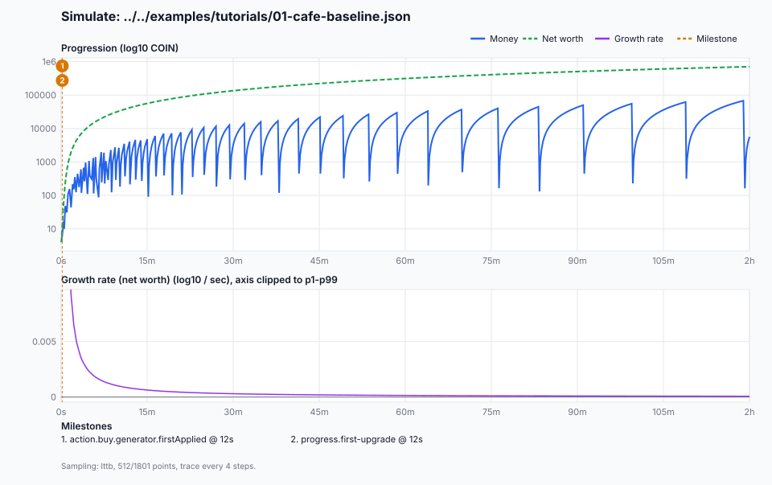
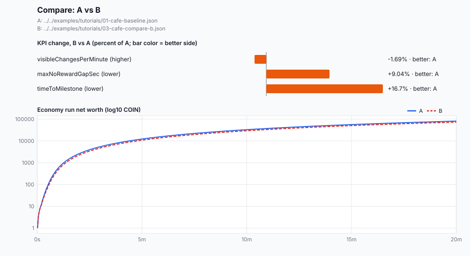
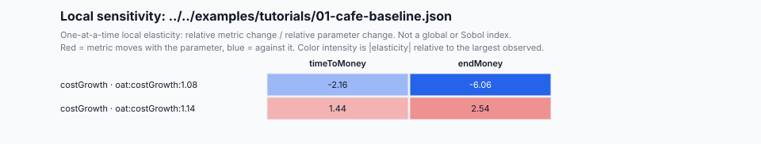

# Charts and decision hints

Korean version: [chart-interpretation_ko.md](./chart-interpretation_ko.md)

idlekit draws charts without a GUI. The CLI writes a self-contained SVG file and, if you ask, the chart data as versioned JSON. Markdown reports add a `## Decision hints` section computed from the same measurements. Neither changes the command's stdout, `--out` file, replay artifact, or run hashes.

## Flags

| Flag | Commands | Meaning |
| --- | --- | --- |
| `--chart-out <file.svg>` | `simulate`, `experience`, `compare`, `experiment` | Write the SVG chart. |
| `--chart-data-out <file.json>` | `simulate`, `experience`, `compare`, `experiment` | Write the chart data (`idlekit.chart-data.v1`). |
| `--chart-max-points <n>` | `simulate`, `experience`, `compare` | Points kept per series, an integer from 3 to 10000. Default 512. |

The two paths must differ from each other and from `--out`, `--artifact-out`, and `--state-out`, and must not name a file the command reads. A bad `--chart-max-points` is a `CLI_USAGE` error. Replay commands recorded in `--artifact-out` leave the chart flags out, so `replay verify` reruns the same result without writing charts. The flags work with `--format json` and `--format md` alike.

Run from `packages/cli`:

```bash
bun run --cwd packages/cli dev -- simulate ../../examples/tutorials/01-cafe-baseline.json --duration 7200 --seed 7 --format json --out ../../tmp/charts/simulate.json --chart-out ../../tmp/charts/simulate.svg --chart-data-out ../../tmp/charts/simulate.chart.json
bun run --cwd packages/cli dev -- experience ../../examples/tutorials/01-cafe-baseline.json --days 1 --format md --out ../../tmp/charts/experience.md --chart-out ../../tmp/charts/experience.svg --chart-data-out ../../tmp/charts/experience.chart.json
bun run --cwd packages/cli dev -- compare ../../examples/tutorials/01-cafe-baseline.json ../../examples/tutorials/03-cafe-compare-b.json --bundle design --format json --out ../../tmp/charts/compare.json --chart-out ../../tmp/charts/compare.svg --chart-data-out ../../tmp/charts/compare.chart.json
bun run --cwd packages/cli dev -- experiment ../../examples/analysis/cafe-cost-growth-experiment.json --format md --out ../../tmp/charts/experiment.md --chart-out ../../tmp/charts/sensitivity.svg --chart-data-out ../../tmp/charts/sensitivity.chart.json
```

## Progression chart



`simulate` and `experience` draw two panels on one time axis. The x axis is time since the run start, labelled in whole seconds, minutes, hours, or days.

- **Top panel, log10 amount.** Money is the solid blue line and net worth the dashed green line (net worth appears when the model defines it). The y axis is log10 of the amount, so a straight rising line is exponential growth and its steepness is the growth rate. A line that bends flat is a softcap or a stall. A saw-tooth money line is spending: the player buys, money drops, and income refills it. Read long-run progress from net worth, which keeps owned value.
- **Bottom panel, growth rate.** The average change of log10 per second between kept points of the primary series (net worth when it exists, money otherwise). A value of 0.001 means the amount multiplies by 10 every 1000 seconds; the doubling time is `log10(2) / rate`. A negative value is a reset, such as a prestige. When early spikes would flatten the rest, the axis is clipped to the 1st–99th percentile and the panel title says so.
- **Milestones.** Dashed orange lines at the first time each milestone was observed, numbered in time order. Badges stack when milestones are close. The list under the chart names them. Up to 12 are drawn; `+N more` points to the chart data for the rest.
- **Sampling note.** The footer names the downsampling method, the kept and offered point counts, and the runner trace interval.

How to read it for design:

- A long flat stretch in the top panel, or a growth rate near zero for a long time, is where players wait. Compare its start with the milestone list to see which purchase or unlock comes before it.
- A first milestone far from the left edge means a slow start. The decision hints compare it with the pacing targets.
- When two runs are compared, compare slopes over the same time window, not end values alone.

## Compare chart



`compare` draws one bar per KPI: the change of B relative to A in percent of A. All bars share one scale, the largest change (at least 1%, at most 1000%; larger changes are clipped and the text shows the real value). The colour names the better side under each metric's preference: green when B is better, orange when A is better, grey for a tie or an undetermined row. The label in brackets is the preference (`higher` or `lower` is better). Values too large for a ratio show `Δlog10`, the difference in orders of magnitude. Below the bars, the A (solid) and B (dashed) economy-run curves show where the difference opens up.

## Sensitivity heatmap



`experiment` draws one row per probe and one column per metric. Each cell is the one-at-a-time local elasticity: the relative metric change divided by the relative parameter change against the baseline. Red means the metric moves with the parameter, blue against it. Colour intensity is the absolute elasticity relative to the largest observed one. Grey cells are unavailable (a censored, failed, or zero-baseline reading) or outside the double range; the cell text keeps the exact value. This is local sensitivity around the baseline, not a global or Sobol index, and parameter interactions are not measured.

## Decision hints

`experience --format md`, `review evaluate`, `review compare`, and `experiment --format md` add `## Decision hints` with three groups. Every line cites a value from the same report.

- **Bottlenecks.** Pacing readings that miss the targets for the scenario's design intent, and stall or softcap windows that cover at least 25% of the sampled growth trace. The default targets are: first visible change by 15s, at least 1 visible change per minute, no reward gap above 180s, and p95 post-purchase feedback within 10s. `frequent-progression`, `scale-fantasy`, and `strategic-optimization` have their own targets.
- **Recommended adjustment direction.** The direction to test and the size of the gap, such as "bring the first visible change forward by about 40%". For slow windows, when exponential windows cover at least 10% of the trace, the hint estimates the window at the run's median exponential slope; otherwise it names where growth leaves the exponential regime. Compare hints name the side that wins more KPIs; experiment hints name the strongest lever per metric with the observed baseline-to-probe change and whether it helps each objective.
- **Risk summary.** Reasons to distrust the numbers: active blocks cut by `maxSteps`, partial milestone coverage, offline time lost to caps or decay above 25%, non-finite end values, censored or failed Monte Carlo draws, simulate UX flags, default LTV assumptions, comparison warnings, and unavailable elasticity cells.

Hints are heuristics, not causal diagnoses. Confirm a change with a matched rerun: the same seed, or `idk compare` of the baseline and the adjusted scenario, or `idk experiment` for a parameter.

## Chart data contract

`--chart-data-out` writes `idlekit.chart-data.v1` ([schema](./schemas/chart-data.v1.schema.json)). `kind` is `progression`, `compare`, or `sensitivity`, and the matching body is present. Times are seconds since the run start. Amount points keep the exact engine text in `value` and plot `y` as log10 of the absolute value, which is `null` for zero. `sampling` records the downsampling, so a consumer can tell kept points from raw ones. The SVG is rendered from this document alone, so the same data gives byte-identical SVG.

Memory stays bounded for long runs. A charted run records only states, every `n` steps, sized so that about four times `--chart-max-points` states are kept; then Largest-Triangle-Three-Buckets keeps the points that preserve the curve's shape, including peaks and resets. Experience runs reuse their sampled session trace.

Node.js and browser runtimes are not part of the v1 compatibility contract.
