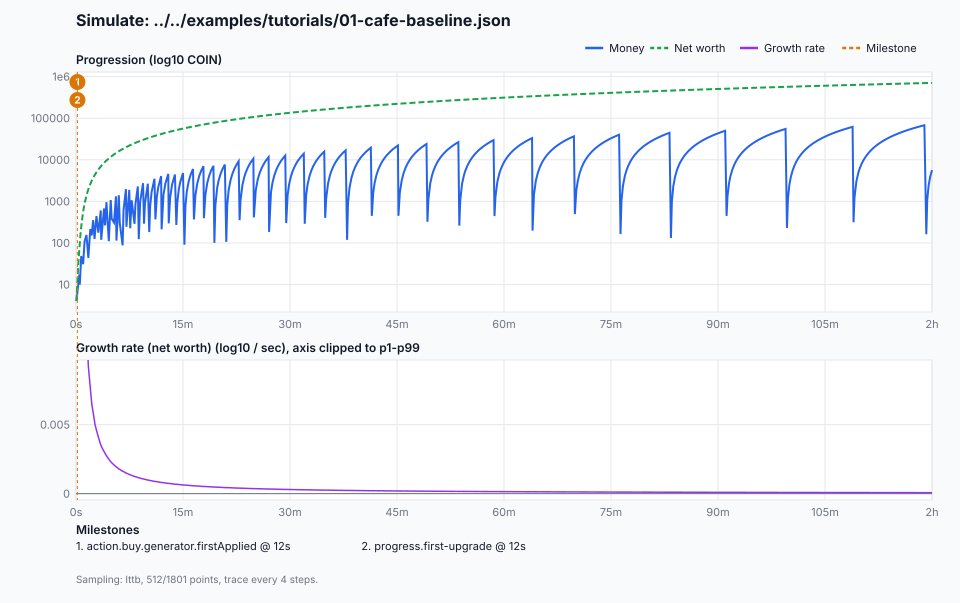
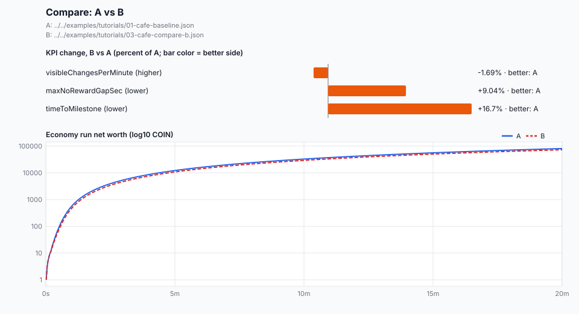
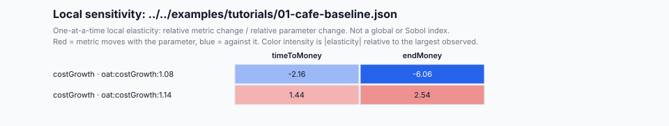

# 차트와 의사결정 힌트

영문 원문: [chart-interpretation.md](./chart-interpretation.md)

idlekit은 GUI 없이 차트를 그린다. CLI는 독립 SVG 파일을 쓰고, 요청하면 차트 데이터를 버전이 붙은 JSON으로도 쓴다. Markdown 리포트에는 같은 측정값으로 계산한 `## Decision hints` 섹션이 붙는다. 둘 다 명령의 stdout, `--out` 파일, replay artifact, 실행 해시를 바꾸지 않는다.

## 플래그

| 플래그 | 명령 | 의미 |
| --- | --- | --- |
| `--chart-out <file.svg>` | `simulate`, `experience`, `compare`, `experiment` | SVG 차트를 쓴다. |
| `--chart-data-out <file.json>` | `simulate`, `experience`, `compare`, `experiment` | 차트 데이터(`idlekit.chart-data.v1`)를 쓴다. |
| `--chart-max-points <n>` | `simulate`, `experience`, `compare` | 시리즈당 남길 점 수. 3~10000 정수, 기본 512. |

두 경로는 서로, 그리고 `--out`, `--artifact-out`, `--state-out`과 달라야 하며, 명령이 읽는 파일을 가리키면 안 된다. 잘못된 `--chart-max-points`는 `CLI_USAGE` 오류다. `--artifact-out`에 기록되는 replay 명령에는 차트 플래그가 빠지므로 `replay verify`는 차트를 쓰지 않고 같은 결과를 다시 낸다. 플래그는 `--format json`, `--format md` 어느 쪽과도 함께 쓸 수 있다.

`packages/cli`에서 실행한다:

```bash
bun run --cwd packages/cli dev -- simulate ../../examples/tutorials/01-cafe-baseline.json --duration 7200 --seed 7 --format json --out ../../tmp/charts/simulate.json --chart-out ../../tmp/charts/simulate.svg --chart-data-out ../../tmp/charts/simulate.chart.json
bun run --cwd packages/cli dev -- experience ../../examples/tutorials/01-cafe-baseline.json --days 1 --format md --out ../../tmp/charts/experience.md --chart-out ../../tmp/charts/experience.svg --chart-data-out ../../tmp/charts/experience.chart.json
bun run --cwd packages/cli dev -- compare ../../examples/tutorials/01-cafe-baseline.json ../../examples/tutorials/03-cafe-compare-b.json --bundle design --format json --out ../../tmp/charts/compare.json --chart-out ../../tmp/charts/compare.svg --chart-data-out ../../tmp/charts/compare.chart.json
bun run --cwd packages/cli dev -- experiment ../../examples/analysis/cafe-cost-growth-experiment.json --format md --out ../../tmp/charts/experiment.md --chart-out ../../tmp/charts/sensitivity.svg --chart-data-out ../../tmp/charts/sensitivity.chart.json
```

## 진행 차트



`simulate`와 `experience`는 같은 시간축에 두 패널을 그린다. x축은 실행 시작부터의 시간이고, 초·분·시간·일 단위의 정수 눈금을 쓴다.

- **위 패널, log10 금액.** 돈은 파란 실선, 순자산은 초록 점선이다(모델이 순자산을 정의할 때만). y축은 금액의 log10이므로 곧게 오르는 선은 지수 성장이고 기울기가 성장률이다. 평평하게 꺾이는 선은 softcap이나 정체다. 톱니 모양의 돈 선은 지출이다: 구매하면 돈이 줄고 수입이 다시 채운다. 장기 진행은 보유 가치를 유지하는 순자산으로 읽는다.
- **아래 패널, 성장률.** 주 시리즈(순자산이 있으면 순자산, 없으면 돈)에서 남긴 점 사이의 초당 log10 평균 변화량이다. 0.001이면 1000초마다 10배가 된다. 두 배 시간은 `log10(2) / 성장률`이다. 음수는 프레스티지 같은 리셋이다. 초반 급등이 나머지를 눌러 버릴 때는 축을 1~99 백분위로 자르고 패널 제목에 표시한다.
- **마일스톤.** 각 마일스톤이 처음 관측된 시각의 주황 점선이며 시간순 번호가 붙는다. 가까운 마일스톤은 배지가 쌓인다. 차트 아래 목록에 이름이 나온다. 최대 12개까지 그리고, 나머지는 `+N more`가 차트 데이터를 가리킨다.
- **샘플링 표기.** 하단에 다운샘플링 방식, 남긴 점과 입력 점 수, 러너 trace 간격이 적힌다.

설계 관점에서 읽는 법:

- 위 패널의 긴 평탄 구간이나 오래 0 근처인 성장률은 플레이어가 기다리는 곳이다. 시작 시각을 마일스톤 목록과 맞춰 보면 어떤 구매나 해금 다음에 오는지 알 수 있다.
- 첫 마일스톤이 왼쪽 끝에서 멀면 시작이 느린 것이다. 의사결정 힌트가 이를 페이싱 목표와 비교한다.
- 두 실행을 비교할 때는 끝값만 보지 말고 같은 시간 구간의 기울기를 비교한다.

## 비교 차트



`compare`는 KPI마다 막대 하나를 그린다: A 대비 B의 변화율(%)이다. 모든 막대는 가장 큰 변화(최소 1%, 최대 1000%)를 한 척도로 공유한다. 더 큰 변화는 잘리고 텍스트에는 실제 값이 나온다. 색은 각 지표의 선호 방향 기준으로 더 나은 쪽이다: B가 낫으면 초록, A가 낫으면 주황, 동률이나 판정 불가면 회색. 괄호 안은 선호 방향(`higher` 또는 `lower`가 좋음)이다. 비율로 담기 어려운 큰 값은 자릿수 차이인 `Δlog10`으로 표시한다. 막대 아래 A(실선)와 B(점선)의 경제 실행 곡선은 차이가 어디서 벌어지는지 보여 준다.

## 민감도 히트맵



`experiment`는 probe마다 행 하나, 지표마다 열 하나를 그린다. 각 칸은 one-at-a-time 국소 탄력성으로, baseline 대비 지표 상대 변화를 파라미터 상대 변화로 나눈 값이다. 빨강은 지표가 파라미터와 같은 방향, 파랑은 반대 방향으로 움직인다는 뜻이다. 색 농도는 관측된 최대 절댓값 대비 절댓값이다. 회색 칸은 사용할 수 없는 값(censored, 실패, baseline 0)이거나 double 범위를 넘는 값이며, 칸 텍스트에 정확한 값이 남는다. 이는 baseline 주변의 국소 민감도이지 전역 민감도나 Sobol 지수가 아니고, 파라미터 간 상호작용은 측정하지 않는다.

## 의사결정 힌트

`experience --format md`, `review evaluate`, `review compare`, `experiment --format md`에는 세 묶음의 `## Decision hints`가 붙는다. 모든 줄은 같은 리포트의 값을 인용한다.

- **Bottlenecks(병목).** 시나리오 설계 의도의 목표를 놓친 페이싱 측정값, 그리고 샘플링된 성장 trace의 25% 이상을 덮는 stall·softcap 구간. 기본 목표는 첫 가시 변화 15초 이내, 분당 가시 변화 1회 이상, 보상 공백 180초 이하, 구매 후 피드백 p95 10초 이내다. `frequent-progression`, `scale-fantasy`, `strategic-optimization`은 각자의 목표를 쓴다.
- **Recommended adjustment direction(권장 조정 방향).** 시험해 볼 방향과 차이의 크기(예: "첫 가시 변화를 약 40% 앞당긴다"). 느린 구간은 지수 구간이 trace의 10% 이상일 때 실행의 지수 기울기 중앙값으로 그 구간 소요 시간을 추정하고, 아니면 성장이 지수 구간을 벗어나는 시각을 알려 준다. 비교 힌트는 KPI를 더 많이 이긴 쪽을, 실험 힌트는 지표마다 가장 강한 레버와 baseline→probe 관측 변화, 그리고 각 목표에 유리한지를 알려 준다.
- **Risk summary(리스크 요약).** 숫자를 그대로 믿기 어려운 이유: `maxSteps`로 잘린 활성 블록, 부분적인 마일스톤 커버리지, 상한·감쇠로 25% 넘게 잃은 오프라인 시간, 유한하지 않은 끝값, censored·실패한 Monte Carlo 표본, simulate UX 플래그, 기본 LTV 가정, 비교 경고, 사용할 수 없는 탄력성 칸.

힌트는 휴리스틱이지 인과 진단이 아니다. 변경은 맞춘 재실행으로 확인한다: 같은 시드, baseline과 조정 시나리오의 `idk compare`, 또는 파라미터의 `idk experiment`.

## 차트 데이터 계약

`--chart-data-out`은 `idlekit.chart-data.v1`([스키마](./schemas/chart-data.v1.schema.json))을 쓴다. `kind`는 `progression`, `compare`, `sensitivity` 중 하나이고 해당 본문이 들어 있다. 시간은 실행 시작부터의 초다. 금액 점은 `value`에 엔진의 정확한 텍스트를 유지하고 `y`에는 절댓값의 log10을 그리며, 0이면 `null`이다. `sampling`이 다운샘플링을 기록하므로 소비자는 남긴 점과 원본 점을 구별할 수 있다. SVG는 이 문서만으로 렌더링되므로 같은 데이터는 바이트 단위로 같은 SVG를 낸다.

긴 실행에서도 메모리는 제한된다. 차트를 그리는 실행은 상태만, `n` 스텝마다 기록하며 `--chart-max-points`의 약 4배 상태가 남도록 간격을 정한다. 이후 Largest-Triangle-Three-Buckets가 피크와 리셋을 포함해 곡선 모양을 보존하는 점을 고른다. experience 실행은 이미 샘플링된 세션 trace를 재사용한다.

Node.js and browser runtimes are not part of the v1 compatibility contract.
